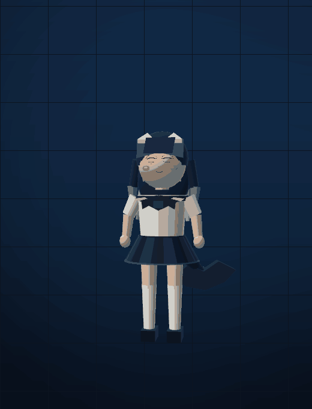

# 鲸鱼娘桌宠 · WhaleGirlPet

> 住在 Windows 桌面上的 3D 鲸鱼娘。透明、置顶、可点击穿透；会走、会打工、会聊天。

> **项目状态（2026-11-28）**：3D 主线已公开 `v3.2.0-sprite`；2D 源码、素材和历史 Release 保留作归档/回滚，不再作为后续发布目标。路线与边界见 [`DECLARATION.md`](DECLARATION.md) 和 [`docs/3d-engine-roadmap-2026-11-28.md`](docs/3d-engine-roadmap-2026-11-28.md)；公开可见度计划见 [`docs/visibility-plan.md`](docs/visibility-plan.md)。

<p align="center">
  
  <br>
  <sub>真实 3D 窗口运行录屏（v3.2.0-sprite）；背景为演示用深色底，非桌面实拍</sub>
</p>

<p align="center">
  <strong>3D 桌面壳主线 · C++/SDL3/OpenGL · 本地大模型/语音 · 2D PySide6 历史归档</strong>
</p>

<p align="center">
  <a href="https://github.com/cnbprd/WhaleGirlPet/releases/latest"></a>
  <a href="LICENSE"></a>
  <a href="https://github.com/cnbprd/WhaleGirlPet/stargazers"></a>
  <a href="https://github.com/cnbprd/WhaleGirlPet/discussions"></a>
</p>

<p align="center">
  <a href="https://github.com/cnbprd/WhaleGirlPet/releases/latest"><strong>下载最新版</strong></a>
  ·
  <a href="https://cnbprd.github.io/WhaleGirlPet/">在线预览</a>
  ·
  <a href="docs/3d-engine-roadmap-2026-11-28.md">路线图</a>
  ·
  <a href="docs/3d-transition.md">3D 技术记录</a>
</p>

---

## 这是什么

一个**本地优先**的 Windows 桌面搭子：不是只会漂浮的动图，而是把 3D 角色、桌面任务、语音、记忆和提醒缝在一起的小应用。

- **透明 3D 壳**：C++/SDL3/OpenGL，窗口透明、置顶、拖拽，卡面区域外的点击可穿透。
- **不是云服务**：账号、聊天、记忆、TTS 缓存默认跟安装文件放在一起；安装目录不可写才回退 `%APPDATA%`，可离线。
- **早期但可跑**：3D 渲染、VRM、SpringBone、17 张卡面、情绪 UDP 总线、无头回归都已落地；认知层还在从 2D 迁移。

> 如果这个“桌面搭子”方向对你有用，点一个 Star 就是最直接的投票；也欢迎在 [反馈帖](https://github.com/cnbprd/WhaleGirlPet/discussions/1) 里提场景和 bug。

## 下载

最新公开版：[`v3.2.0-sprite`](https://github.com/cnbprd/WhaleGirlPet/releases/tag/v3.2.0-sprite)（2026-11-28 发布）

| 文件 | 用途 |
|---|---|
| `WhaleGirlPet-Setup-3.2.0-sprite.exe` | Windows 安装包；默认装到 `F:\WhaleGirlPetApp`（无 F 盘则回退），目录页可改 |
| `whale3d-whale-girl-v3.2-sprite.zip` | 便携包；解压后运行 `whale3d.exe` |
| `whale3d.exe` | 单独 exe，适合已经装过 3.1.2 的用户替换 |
| `*.sha256` | 安装包校验值；当前未签名，SmartScreen 可能提示“未知发布者” |

安装包和 exe 仍为 `NotSigned`：项目没有代码签名证书，SignPath Foundation 申请已于 2026-11-27 被拒。先核对 `.sha256` 再决定是否运行；不要用自签名冒充正式发布。

## 当前 3D 主线

`v3.2.0-sprite` 是当前公开版。它把“身体”先接上了，认知层还没有完全搬进来：

| 能力 | 状态 |
|---|---|
| 透明无边框 3D 窗口、置顶、拖拽 | 已通；420×620，OpenGL 3.3 |
| 点击穿透 / Win11 托盘固定 / 同进程 in-place 换模 | 已通；真实鼠标和四轮内存实测在 `docs/3d-transition.md` |
| 角色格式 | 最小 VRM 1.0 `3d/assets/models/whale_girl.vrm`，19 humanoid bones + 4 条两骨 SpringBone |
| 基础动画 | ozz 采样 idle/walk；自研采样保留 A/B |
| 头发/尾巴二次动力学 | 已通；窗口位移惯性输入，`WHALE3D_SPRING=0` 可关闭 |
| 情绪参数总线 | v3.2 step 1/1b/4/5 已通；本机 UDP `127.0.0.1:47832`；`happy 0.8` 是 80% 的笑，`curve.attack_ms/release_ms` 控制进出包络；可选 `gaze/lean` 转 head/neck、倾 spine/chest，见 `docs/3d-emotion-bus.md` |
| 姿态层 | v3.2 step 5 已通；可选 `gaze` / `lean` 小角度骨旋转，180/420 ms 平滑/回正；只是“转头”不是眼骨/BlendShape，见 `docs/3d-emotion-bus.md` |
| 认知层 | Python 侧已接情绪桥：`P_USER / P_LLM / P_AUTO` 仲裁后发本机 UDP；ASR 单句输入已接 Python 输入层，不直接进 3D 渲染；TTS 仍只延长 `P_LLM` |
| 情绪桥 | v3.2 step 3 已通；聊天发送/回复/情绪衰减三路接入，TTS 实际播放期间延长 P_LLM，3D 端日志可看到 `source=P_USER/P_LLM`，见 `docs/3d-emotion-bus.md` |
| 2D 卡面层 | v3.2 sprite 已接 3D 主循环；17 张 `expression/*` / `action/*` 卡通过 UDP `card` + `card_ttl_ms` 触发，TTL 淡入淡出，右下角绘制；设计上只扩窗口 region、不进入 `hitTest`，真实点击穿透仍待采样；见 `docs/sprite-layer.md` |

细节：[`3d/README.md`](3d/README.md)、[`docs/3d-transition.md`](docs/3d-transition.md)。下面的“功能概览”是 2D 历史归档能力，不代表当前 3D 核心包已全部迁移。

---

## 功能概览

| 模块 | 能力 | 说明 |
|---|---|---|
| 桌宠本体 | 透明无边框、始终置顶、拖拽、站立/走/跑/摔倒/翻滚 | 真透明合成（不用硬边蒙版），窗口外扩 18% 给动作留活动余量 |
| 养成系统 | Lv / 经验 / 金币 / 饱食度 / 心情 / 亲密度 | 投喂四种零食，拍拍涨好感，频繁戳会抗议 |
| 打工任务 | 写工作总结、学习知识点、清理临时目录 | 完成结算金币与经验，清理只动临时目录 |
| 时间管理 | 定时任务、喝水 / 久坐提醒、22 点休息 | 夜间自动切换成低活动量 |
| 聊天 | 流式对话、气泡模式、聊天面板 | 支持 OpenAI 兼容 / 智谱 / Ollama / dafeiyu.cpp 本地模型 |
| 语音 | Edge TTS + 8 种方言人格 + 真人音色提炼 + 唤醒词 | 唤醒词：`大肥鱼`、`你好，大肥鱼`、`你好，<当前角色名>` |
| 记忆与知识 | 长期记忆、知识库、联网搜索 | 对话里自动召回 |
| 环境播报 | 天气、科技新闻、全屏自动躲避、拔电省电 | 全屏应用时自动隐藏，退出全屏回来 |
| 桌面维护 | 满屏跑撞图标掉落与复位、桌面擦除、垃圾清理 | 图标掉落后会自己慌张地摆回去 |
| 安全体检 | 启动项 / 防火墙 / 补丁 / 账号风险分项检查 | 只读检查项与本地模拟修复，不做破坏性操作 |
| 外观 | 多形态多皮肤、三档主题（跟随系统 / 浅色 / 深色）、macOS 风格侧边栏面板 | 主题读注册表 `AppsUseLightTheme` |
| 更新 | GitHub Releases 检查 + 分块下载 + SHA256 校验 | 同版本不提示，装机版自动调安装器 |

---

## 快速开始

### 方式一：3D 核心包（当前主线）

最新 `v3.2.0-sprite` 已上传 Release，直接看上方 [下载](#下载)。`v3.2.0-dev` 是上一轮预发布，`v3.1.2` 是更早的稳定版；历史资产都在 [Releases](https://github.com/cnbprd/WhaleGirlPet/releases)。

| 文件 | 说明 |
|---|---|
| `WhaleGirlPet-Setup-3.2.0-sprite.exe` | 当前公开安装包；无需管理员权限，目录页可改安装位置 |
| `whale3d-whale-girl-v3.2-sprite.zip` | 当前公开便携包，解压即用 |
| `v3.2.0-dev` / `v3.1.2` | 历史候选/稳定版，保留用于回滚和对照 |

安装包当前未签名；SmartScreen 若提示“未知发布者”，请先对照同名 `.sha256` 校验，再选择“更多信息 → 仍要运行”。受信任代码签名方案和接入条件见 [`docs/code-signing.md`](docs/code-signing.md)。

### Code signing policy

Status (2026-11-27): the SignPath Foundation application was reviewed and **not approved**. SignPath cited insufficient public adoption/visibility signals (GitHub stars, forks, contributors, external references) and invited a reapplication after the project gains broader recognition. The current Release artifacts remain unsigned and Windows may show “Unknown publisher”; details in [`docs/code-signing.md`](docs/code-signing.md) and [`docs/signpath-response-2026-11-27.md`](docs/signpath-response-2026-11-27.md).

We do not use a self-signed certificate as a substitute for a trusted signature. If a trusted certificate is obtained, the signing scope will be the Windows artifacts: `whale3d.exe` and `WhaleGirlPet-Setup-<version>.exe`. Authors / reviewers / approver: [cnbprd](https://github.com/cnbprd) (repository owner); all team members use MFA for GitHub and the signing service. Full policy: [`CODE_SIGNING_POLICY.md`](CODE_SIGNING_POLICY.md). Privacy statement: [`PRIVACY.md`](PRIVACY.md).

2D 安装包是历史归档，不再作为新版本发布目标；下表只用于旧 Release 说明：

| 文件 | 说明 |
|---|---|
| `WhaleGirlPet-Setup-x.y.z.exe` | 2D 安装包，含开始菜单与卸载项（历史） |
| `WhaleGirlPet-x.y.z-portable.zip` | 2D 免安装，解压即用（历史；onedir：根目录里是 `WhaleGirlPet.exe` + `_internal\`，别只拖走 exe） |
| `WhaleGirlPet-x.y.z-source.zip` | 源码快照（历史） |
| `*.sha256` | 校验值，`certutil -hashfile <文件> SHA256` 对比 |

### 方式二：3D 源码构建

```powershell
git clone https://github.com/cnbprd/WhaleGirlPet.git
cd WhaleGirlPet
powershell -ExecutionPolicy Bypass -File 3d\build.ps1
.\3d\whale3d.exe
```

工具链、SDL3、ozz 静态库和模型说明见 [`3d/README.md`](3d/README.md)。`3d\build.ps1` 编译 `main.cpp` / `model.cpp` / `shell_ui.cpp` / `sprite.cpp`，不依赖 Qt 或 Python。

### 方式三：2D 源码运行（历史归档）

```powershell
py -3.11 -m venv .venv
.\.venv\Scripts\python.exe -m pip install -r requirements.txt
.\.venv\Scripts\python.exe app\main.py
```

> 本地大模型（可选）：把 `dafeiyu.cpp` 运行时与 `.gguf` 模型放到 `runtime/`，程序会自动探测；不装则退回在线接口。
> 想让她能看屏幕（本地视觉）：再放一份与主权重配套的 `mmproj*.gguf`（例如 `gemma4-e2b-it.gguf` 配 `mmproj-gemma4-e2b-f16.gguf`）到同一目录，启动时自动加 `--mmproj`。

### 打包自己的版本

```powershell
.\build.ps1                 # PyInstaller onedir → dist\WhaleGirlPet\ （exe + _internal）
tools\inno\ISCC.exe installer\whale_pet.iss   # Inno Setup → dist\WhaleGirlPet-Setup-x.y.z.exe
```

> v3.0.18 起是 **onedir**：发布物是一个目录，不是单个 exe。单文件（onefile）每次冷启动都要把 64MB 解到 `%TEMP%`，实测就绪 4.55s / 常驻 170MB；onedir 是 0.76s / 83MB。

---

## 目录结构

```
WhaleGirlPet/
├── app/                 # 全部业务代码（PySide6 + 线程 + 本地模型接入）
│   ├── main.py          # Controller：托盘、快捷键、语音、自主行动、定时
│   ├── pet_window.py    # 桌宠窗口：绘制、动作、拖拽、右键菜单
│   ├── panel.py         # 控制面板：10 个页面 + 侧边栏
│   ├── panel_v2.py      # 音频库 / 自定义模型 / 安全 / 账号 / 定时任务（记忆页已不挂载）
│   ├── tts.py           # Edge TTS 封装 + 音色档位
│   ├── voice_profile.py  # 真人音色提炼映射（基频 → pitch 反查）
│   ├── updater.py       # GitHub Releases 检查与下载校验
│   ├── theme.py         # auto / light / dark 解析
│   └── …                # 养成、任务、记忆、安全、天气、图标等模块
├── assets/              # 立绘、表情、UI qss、音效
├── installer/           # Inno Setup 脚本
├── docs/                # 架构、功能、更新日志
├── build.ps1            # 一键打包
└── WhaleGirlPet.spec    # PyInstaller 配置
```

架构与模块边界见 [`docs/ARCHITECTURE.md`](docs/ARCHITECTURE.md)。

---

## 配置

配置与数据默认在安装目录（与 `whale3d.exe` / `WhaleGirlPet.exe` 同级）；安装目录不可写时回退 `%APPDATA%\WhaleGirlPet\`。旧版指针 `data_root.txt` 仍兼容。

| 路径 | 内容 |
|---|---|
| `accounts\<档案>\config.json` | 位置、缩放、皮肤、主题、语音、AI 后端等 |
| `accounts\<档案>\voices\` | 音效与 TTS 缓存 |
| `memory\`、`kb\` | 记忆库与知识库 |

常用配置项：

| 键 | 默认 | 说明 |
|---|---|---|
| `theme` | `auto` | `auto` / `light` / `dark` |
| `mute_idle` | `true` | 静音模式：闲聊/播报只出气泡不出声 |
| `tts_on` | `false` | 是否用 TTS 说话 |
| `voice_profile` | `linluo` | 音色档位（`linluo` / `jingjing` / `off`） |
| `alpha_mask` | `false` | 硬边蒙版开关（开启会有锯齿与裁边，默认关） |
| `auto_on` | `true` | 自主行动 |
| `update_repo` | `cnbprd/WhaleGirlPet` | 联网更新仓库 |

---

## 快捷键

| 组合 | 作用 |
|---|---|
| `Alt+Shift+F` | 显示 / 隐藏桌宠 |
| `Ctrl+Alt+V` | 语音说一句（先说唤醒词再说话可连续对话） |

托盘图标：左键单击切换显示，右键出菜单（面板 / 显示隐藏 / 自主行动 / 静音 / 主题 / 退出）。

---

## 已知限制

- 立绘放大到 0.7 倍时素材 alpha 边缘会有台阶（非蒙版造成），需要 2 倍超采样才能彻底平掉。
- 摔跤类 60°+ 翻转贴到屏幕最边缘时，仍可能轻微出界。
- 不同皮肤立绘来自不同批次的生成，脸与服装细节不完全一致（正在统一重绘）。
- 语音唤醒需要先按 `Ctrl+Alt+V`，不是常驻离线监听。
- 仅支持 Windows（依赖 `winreg`、DWM、`GetSystemPowerStatus`）。

---

## 更新日志

见 [`CHANGELOG.md`](CHANGELOG.md)。当前公开版本 **v3.2.0-sprite**；上一轮预发布 v3.2.0-dev，更早稳定版 v3.1.2。

---

## 贡献

1. Fork，建分支 `feat/your-feature`
2. 提交信息建议 [Conventional Commits](https://www.conventionalcommits.org/)
3. 发 PR，附上复现步骤或截图

提交前请确认没有把 `dist/`、`build/`、`runtime/`、`.venv/`、安装目录下的账号/配置/密钥带进来。

---

## 许可与声明

代码以 [MIT](LICENSE) 许可开源。

- 角色形象为 DeepSeek 鲸鱼娘（社区昵称「大肥鱼」）的同人二创，**角色相关权利归原权利方**，本仓库不主张任何角色版权。
- 立绘与音效由生成/公开素材整理而来，仅供个人非商业使用；商业用途请自行确认授权。
- 本项目与 DeepSeek 官方无隶属关系。
- 代码与素材的边界见 [`ASSET-NOTICE.md`](ASSET-NOTICE.md)。

### 第三方与参考（动画引擎）

`app/skeletal.py`（v3.0.13 起的骨骼动画）**未复制任何第三方源码**，代码自写，
仅在架构设计上参考了两份开源资料，完整声明见 [`docs/THIRD_PARTY.md`](docs/THIRD_PARTY.md)：

- **Godot Engine 4.x** 的 2D 骨骼系统（`Skeleton2D` / `Bone2D` / `Polygon2D` 顶点权重蒙皮），MIT 许可 —
  https://docs.godotengine.org/en/stable/tutorials/animation/2d_skeletons.html
- **Inochi2D**（开源 2D rigging，Live2D 的开源替代），BSD 2-Clause —
  https://inochi2d.com

明确**未使用**：Spine Runtime（许可要求最终用户自行持有 Spine Editor 授权，不适合免费分发）、
Live2D Cubism SDK（专有许可）。

如果这个项目对你有用，点个 Star 就是最实在的支持。

